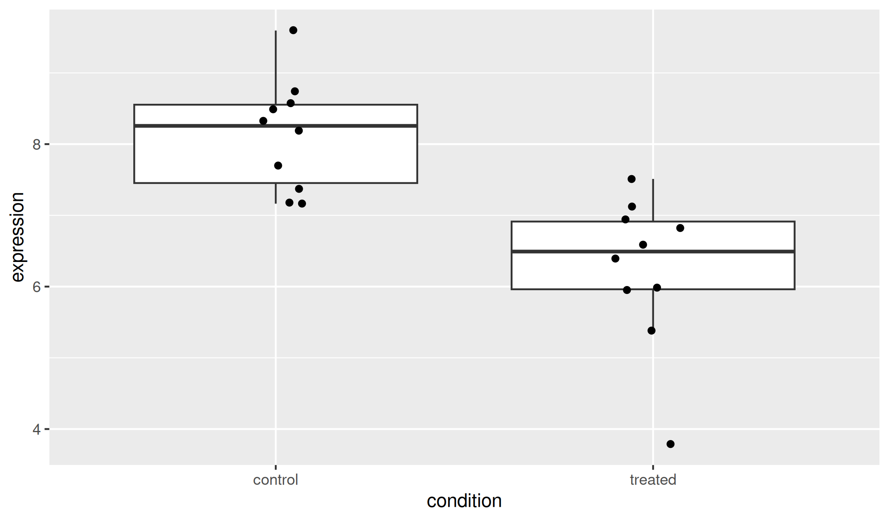
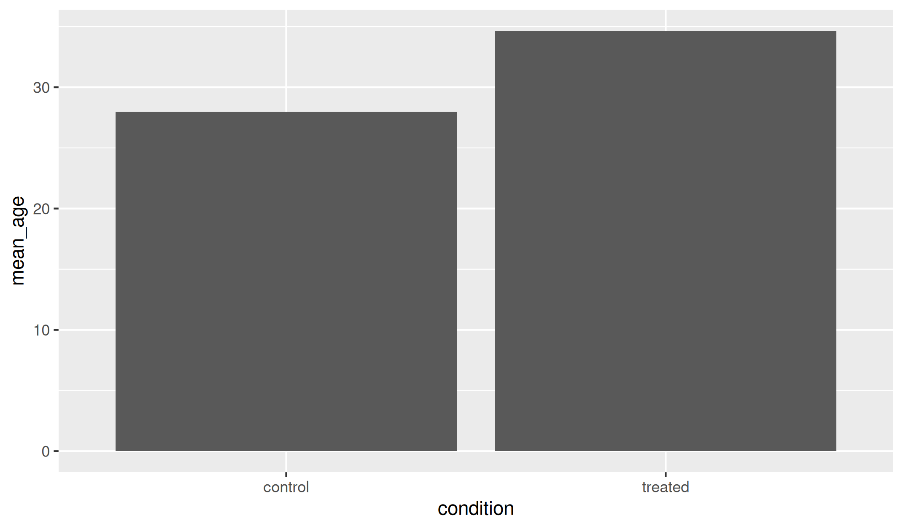

# R-bioinformatics-journey

Learning bioinformatics in public: R scripts, practice exercises, and small genomics analysis projects.

## Progress

- Day 1: R data structures (vectors, matrices, factors, data frames, lists) ✅
- Day 2: read.csv and dplyr (filter, select, mutate, arrange, group_by, summarise) ✅
- Day 3: ggplot2 boxplot with jittered points ✅ 
- Day 4: bar plot and t-test ✅
- Day 5: recall + genes2 ✅
